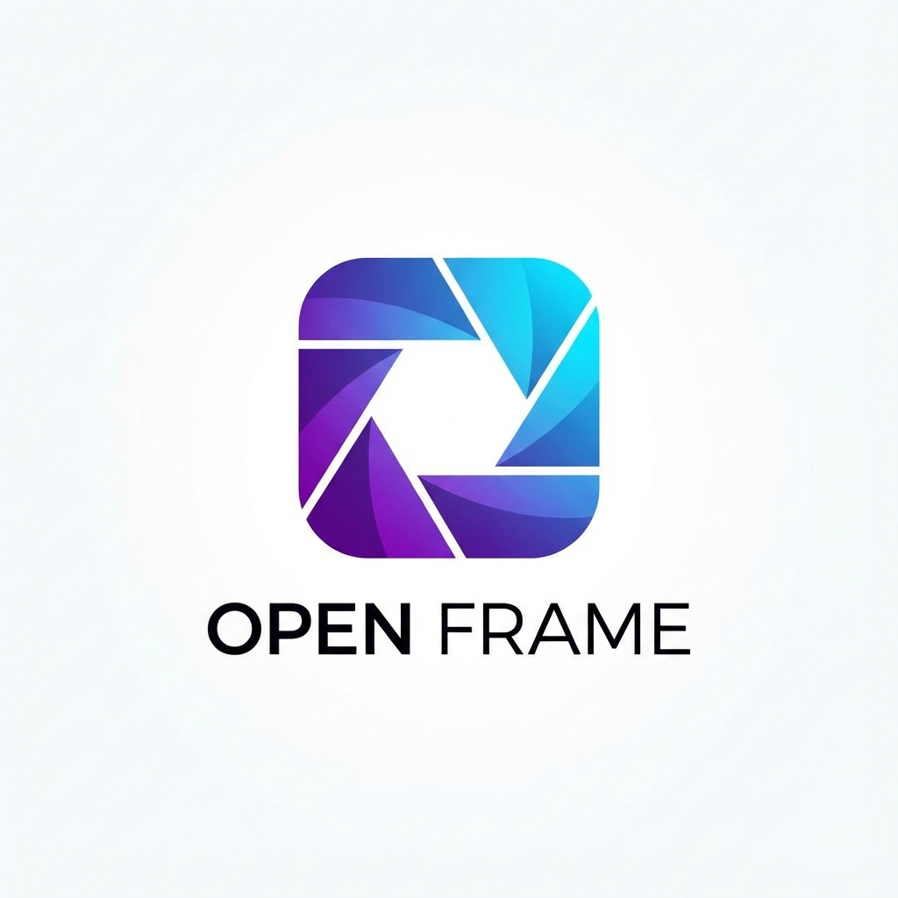

# Open Frame - Desktop App

Modern, password-protected photo management application for Ubuntu.



## Features

- 🔒 **Password Protection** - Secure your photo gallery with password authentication
- 📁 **Local Storage** - All photos stored locally on your machine
- 🎨 **Modern UI** - Beautiful dark theme with glassmorphism effects
- 📸 **Smart Import** - Import photos from your computer
- 🔍 **Search** - Quickly find photos by filename
- 🖼️ **Photo Viewer** - View full-size photos with metadata
- ⚡ **Fast Performance** - Thumbnail generation for quick loading
- 🖥️ **Desktop App** - Runs as a standalone application

## Quick Start

### Launch as Desktop App (Recommended!)

Simply run:
```bash
cd "/home/suryansh/Projects/Open Frame"
./open-frame-desktop.sh
```

This will:
1. Start the background server
2. Open the app in a standalone window (looks like a native app!)
3. You can also find "Open Frame" in your Ubuntu applications menu

### Or Install to Ubuntu Launcher

The app is already installed! Just:
1. Press the Super key (Windows key)
2. Type "Open Frame"
3. Click the app to launch

## Usage

1. **First Launch**: Create a password to protect your photos
2. **Import Photos**: Click the Import button and select photos
3. **Browse**: View your photos in a beautiful grid layout
4. **Search**: Use the search bar to find specific photos
5. **View Details**: Click any photo to see it full-size with metadata

## Installation

Dependencies are already installed. If you need to reinstall:

```bash
cd "/home/suryansh/Projects/Open Frame"
npm install
```

## Supported Image Formats

- JPEG (.jpg, .jpeg)
- PNG (.png)
- GIF (.gif)
- WebP (.webp)
- BMP (.bmp)
- TIFF (.tiff)

## Data Storage

All photos and data are stored locally in:
```
~/.openframe-web/
├── photos/           # Your imported photos
│   └── thumbnails/   # Generated thumbnails
└── openframe.db      # Database with photo metadata
```

## Stopping the Server

If you need to stop the background server:
```bash
pkill -f "node server.js"
```

## Troubleshooting

### Can't launch the app
Make sure the script is executable:
```bash
chmod +x open-frame-desktop.sh
```

### Port 3000 already in use
Stop any existing servers:
```bash
pkill -f "node server.js"
```

### Browser doesn't open
You can manually visit: `http://localhost:3000`

## Technical Details

- **Backend**: Node.js with Express.js
- **Database**: SQLite (better-sqlite3)
- **Image Processing**: Sharp
- **Security**: bcrypt password hashing
- **Session Management**: express-session

## Why Not Electron?

This app runs in your browser instead of Electron due to compatibility issues with Ubuntu 24.04 Wayland. The browser app mode provides the exact same experience as a native desktop app!

## License

MIT
